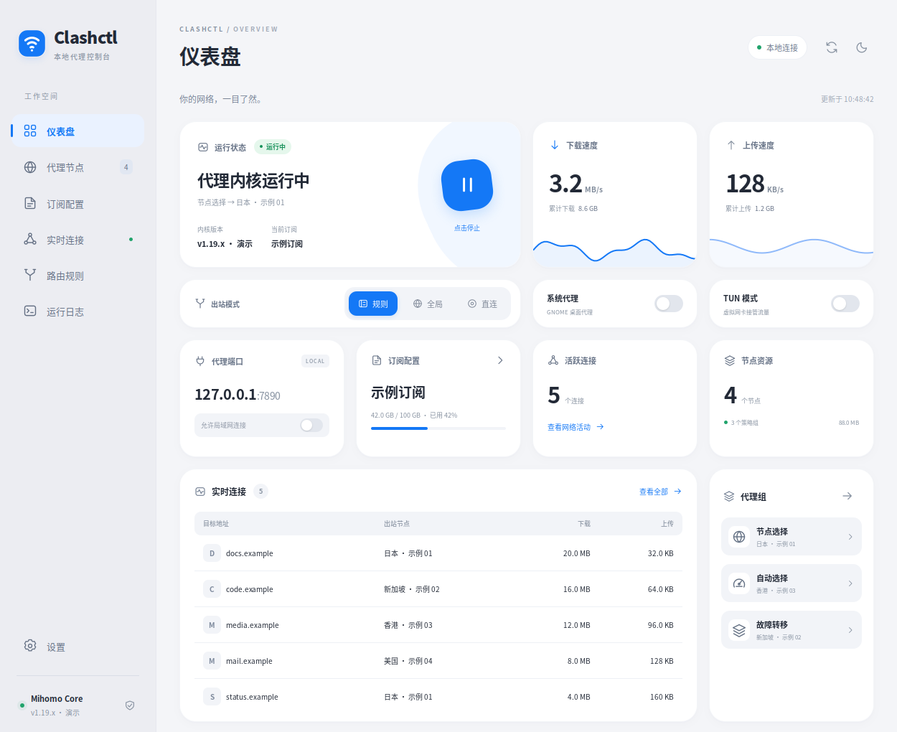

# Clashctl Desktop

一个为 [clashctl](https://github.com/nelvko/clashctl) / Mihomo 提供图形界面的 Linux 客户端。参考 FlClash 的侧栏和卡片布局，支持实时流量、节点切换、测速、订阅管理、连接、规则和日志。

**克隆后执行一个安装命令，安装完成即可从应用菜单打开。** 不需要 Node.js、Flutter 或额外的 Python pip 包。



> 截图为演示数据。项目不提供代理服务器、订阅或共享节点；使用者需要添加自己的 Clash / Mihomo 订阅。

## 一键安装

适用 Ubuntu 20.04 / 22.04 / 24.04、Debian，以及 Linux **x86_64 / ARM64**。Jetson ARM64 已验证。桌面模式使用 GTK 3，自动选择 WebKitGTK 4.1 或 4.0；没有桌面环境可以使用浏览器模式。

```bash
git clone https://github.com/prettydoglee/clashctl-desktop.git
cd clashctl-desktop
bash install.sh
```

请以普通用户执行，安装系统软件包时会调用 `sudo`。安装器会安装系统依赖、检查并安装 clashctl、复制控制台、创建应用菜单和桌面入口，然后自动打开窗口。

如果已经安装了 clashctl，安装器会复用现有安装及订阅。新安装的控制接口仅监听 `127.0.0.1`，默认不接管整个系统网络。首次打开点击 **添加订阅**，输入自己的订阅名称和链接；第一个订阅会自动启用。随后可在仪表盘开启系统代理，或按需启用 TUN。

GitHub 直连下载困难时，可以显式指定自己信任的下载代理前缀：

```bash
bash install.sh --gh-proxy https://你的下载代理域名
```

该前缀仅用于下载 clashctl 源码及其组件，不用于提交订阅链接。

## 启动与使用

应用菜单搜索 **Clashctl**，或双击桌面的 **Clashctl**。命令行也可以启动：

```bash
clashctl-ui
```

安装后新开终端即可找到命令；当前终端也可运行 `~/.local/bin/clashctl-ui`。关闭控制台窗口后，代理内核继续由 clashctl 管理。

没有 Linux 桌面，或只希望使用网页：

```bash
bash install.sh --web --no-launch
~/.local/bin/clashctl-ui --serve
```

打开 `http://127.0.0.1:17890`。仅监听本机，远程主机请使用 SSH 端口转发：

```bash
ssh -L 17890:127.0.0.1:17890 用户名@主机
```

端口已被占用时加 `--port 17891`。桌面和浏览器模式默认共用同一个端口。

## 功能

| 页面 | 支持操作 |
| --- | --- |
| 仪表盘 | 真实内核状态、上传和下载速率、最近一分钟曲线、累计流量、连接和节点数量 |
| 代理节点 | 切换手动策略组、单节点测速、组内并发测速、搜索和排序 |
| 订阅配置 | 添加原生 Clash / Mihomo 订阅、首次自动启用、更新、切换、流量和到期信息 |
| 实时连接 | 查看目标、进程、命中规则、出站链路和流量，搜索及关闭单个连接 |
| 路由规则 | 查看并搜索内核规则 |
| 日志 | 最新 250 行、筛选、暂停更新 |
| 设置 | 规则 / 全局 / 直连、局域网访问、IPv6、日志级别、DNS 缓存清理 |
| 桌面 | 深浅色主题、响应式布局、GNOME 系统代理、TUN 授权终端 |

规则模式等设置会校验候选配置后保存到 clashctl 的 Mixin 和运行配置中，重启后生效。订阅、内核启停及 TUN 操作调用原有 clashctl；需要管理员权限时打开授权终端。

GNOME 系统代理影响遵循桌面设置的应用，已有终端的代理变量仍通过 `clashctl on` / `clashctl off` 管理。切换 TUN 会短暂重启内核。托盘、全局快捷键、WebDAV 和配置编辑器暂未提供。

## 开机启动

普通代理内核沿用 clashctl 的登录自启设置。需要 **TUN 模式开机启动**时：

```bash
bash install.sh --tun-autostart
```

这个可选操作需要 `sudo` 和 systemd。它创建按用户 UID 命名的系统服务，使用 clashctl 原有的特权进程记录，保留 `clashctl start` / `stop` / `tun` 的兼容性。仅在保存的配置启用了 TUN 时启动，不会因为安装这个服务而自动开启 TUN。

禁用未来的 TUN 开机启动：

```bash
sudo python3 ~/.local/share/clashctl-desktop/scripts/tun_autostart.py \
  --uid "$(id -u)" --clashctl-home "$HOME/.clashctl" --disable
```

## 安装选项

```text
--web                  仅浏览器模式
--no-launch            安装完成后不打开窗口
--tun-autostart        安装可选 TUN 开机服务
--skip-deps            系统依赖已提供，不调用 apt
--skip-clashctl        仅使用现有完整 clashctl 安装
--prefix PATH          控制台安装目录
--bin-dir PATH         命令入口目录
--clashctl-home PATH   clashctl 安装目录
--gh-proxy URL         可选 GitHub 下载代理前缀
--service MODE         auto / systemd-user / nohup
```

默认控制台安装至 `~/.local/share/clashctl-desktop`，命令位于 `~/.local/bin/clashctl-ui`，clashctl 数据保留在 `~/.clashctl`。桌面偏好使用 XDG 数据 / 缓存目录，系统代理恢复备份存放于 `~/.local/state/clashctl-ui`。

同一用户请使用一个运行中的 clashctl 安装。使用自定义目录时，先停止其他目录的内核，避免上游按 UID 管理的 TUN 特权进程记录发生冲突。

## 更新与卸载

先关闭控制台，在克隆的源码目录运行：

```bash
git pull --ff-only
bash install.sh
```

重复安装保留已存在的订阅和内核配置。clashctl 自身及 Mihomo 内核分别通过 `clashctl update`、`clashctl upgrade` 管理。

卸载控制台：

```bash
bash ~/.local/share/clashctl-desktop/uninstall.sh
```

卸载仅移除安装器管理的界面、命令和桌面入口；订阅、clashctl、用户偏好及可选 TUN 服务保留。启用过系统代理时，请先在界面关闭以恢复之前的设置；可选 TUN 服务按上节命令另行禁用。

## 诊断

```bash
clashctl-ui --doctor
clashctl-ui --version
```

诊断会检查安装路径和组件，不显示控制密钥或订阅链接。桌面窗口默认使用软件渲染，已处理 ARM / X11 下页面加载正常但实际窗口白屏的问题。网页加载失败时会显示原因，并提供重新加载与浏览器入口。

仅网页模式不需要 GTK；手动安装桌面依赖时需 Python 3.8+、PyGObject、GTK 3、WebKitGTK 4.1 或 4.0、xdg-utils，以及终端模拟器。自动依赖安装使用 apt，其他发行版可自行提供这些组件后使用 `--skip-deps`。

## 开发和检查

```bash
python3 -m unittest discover -s tests -p 'test_*.py' -v
bash -n install.sh uninstall.sh launch.sh clashctl-bridge.sh
```

配置测试使用临时目录，复用已安装 clashctl 的解析、合并和 Mihomo 校验器，不修改真实代理配置。可用 `CLASHCTL_TEST_HOME` 指定测试组件目录。没有安装测试组件时相关测试会跳过；GitHub Actions 会先进行全新隔离安装，再运行完整测试。

WebKit 界面检查需要一个正在运行的本地控制台：`python3 tests/desktop_check.py`。关闭桌面控制台后可运行 `python3 tests/desktop_native_check.py`，它验证实际 X11 窗口像素、数据加载和错误恢复，防止仅通过离屏截图漏掉白屏问题。这两项检查会读取本机代理数据，其 `preview*.png` 已加入忽略列表。

公开截图通过 `tests/demo_server.py` 的虚构数据生成，不读取个人订阅或流量。

## 依赖与许可

本项目代码采用 [MIT License](LICENSE)。clashctl、Mihomo、yq 和系统库的来源及各自许可见 [THIRD_PARTY_NOTICES.md](THIRD_PARTY_NOTICES.md)。安装器固定 clashctl 引导代码版本，并让其管理内核组件；本仓库不打包个人数据、代理二进制或第三方订阅。

界面参考 [FlClash](https://github.com/chen08209/FlClash)，独立实现，非 FlClash 官方项目。内核接口参照 [Mihomo API](https://wiki.metacubex.one/api/)。
